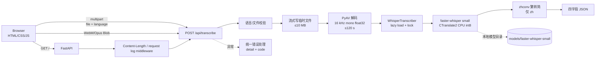

# 设计说明（Design）

- 文档版本：v1.0（P7 交付版）
- 日期：2026-10-28
- 关联：`README.md`、`docs/requirements.md`、`docs/test-report.md`
- 实现基线：`app/`、`static/`、`scripts/`、`tests/`

## 1. 总体架构



- 单进程、单模型、单用户。
- 没有数据库、消息队列、缓存、认证服务或前端构建工具。
- 浏览器与后端同源；默认只绑定 `127.0.0.1`。
- 模型在首次请求时加载，加载后常驻进程。

## 2. 模块职责

| 模块 | 职责 |
| --- | --- |
| `static/index.html` | 页面结构：语言、录音、上传、pipeline、结果、错误 |
| `static/styles.css` | 状态样式、响应式布局、焦点/错误样式 |
| `static/app.js` | 状态机、MediaRecorder、计时、上传、结果、复制、错误/重试 |
| `app/main.py` | `create_app()`、中间件、静态页、生产 `app`、日志配置 |
| `app/api/routes.py` | `/health`、`/api/transcribe`、请求编排 |
| `app/services/audio.py` | 扩展名/语言/空文件/WAV 头校验、流式大小限制、PyAV 解码、时长限制、临时文件清理 |
| `app/services/transcriber.py` | `Transcriber` 协议、Fake、Whisper 惰性加载/锁/推理、语言与耗时日志 |
| `app/services/text.py` | `zhconv` 繁转简 |
| `app/services/metrics.py` | CER/WER、脚本占比（测试与日志用） |
| `app/errors.py` | `ApiError` 体系、统一 JSON、4xx/5xx、异常日志 |
| `app/config.py` | 环境变量 -> 不可变 `Settings` |
| `scripts/download_model.py` | 唯一联网入口：下载/校验本地模型 |
| `scripts/verify_asr.py` | 不启动 Web 的 CLI 真实模型冒烟 |
| `tests/` | 默认单测、真实模型、E2E、前端静态契约 |

## 3. 请求流程

### 3.1 页面加载

1. `GET /` 返回 `static/index.html`。
2. `GET /static/styles.css`、`/static/app.js`、`/static/favicon.svg` 由 FastAPI 静态目录提供。
3. 页面初始为 `idle`，不调用 `getUserMedia`。
4. 请求日志中间件生成/接收 `X-Request-ID`，响应头回传。

### 3.2 麦克风录音

```text
点击 Start
→ state=requesting，状态“正在请求麦克风权限…”
→ getUserMedia({channelCount:1, echoCancellation, noiseSuppression, autoGainControl})
→ 选择 MediaRecorder MIME：webm/opus → webm → ogg/opus → ogg → mp4 → 浏览器默认
→ recorder.start(1000)，state=recording
→ 200 ms 计时，显示 00:00.0
→ 60 s 自动 stop（或用户 Stop）
→ 合并 chunks 为 Blob
→ state=transcribing，FormData(file, language)
→ POST /api/transcribe
→ success/error
```

关键点：

- 只有点击 Start 后才请求权限。
- 停止后才提交完整音频；录音中不发送分片。
- `recordingFailed` 防止 MediaRecorder error 后的 stop 事件被误当作成功。
- 60 秒计时达到后自动停止并提交，页面提示“已达到 60 秒上限”。
- 录音 Blob 的 MIME 由 `MediaRecorder.mimeType` 记录，扩展名由 MIME 推导。

### 3.3 文件上传

```text
选择文件
→ 客户端预检：扩展名、空文件、>10 MB
→ 合法后启用 Upload
→ FormData(file, language)
→ POST /api/transcribe
```

客户端与服务端使用同一接口；客户端校验只用于即时反馈，不替代服务端校验。

### 3.4 后端识别

```text
POST /api/transcribe
→ Content-Length 中间件（明显超限直接 413）
→ validate_language(zh/en)
→ process_audio_upload
   → validate_upload：扩展名白名单、空文件、WAV 头早期检查
   → save_upload_to_temp：1 MiB 分块写入，精确 ≤10 MB
   → decode_audio：PyAV → 16 kHz mono float32，容器/样本双重 ≤120 s
   → finally cleanup 临时目录
→ transcriber.transcribe(samples, language)  (线程池)
   → 首次加载模型（lock）
   → faster-whisper beam=5, VAD=true
   → 合并 segment 文本
   → zh 时 zhconv 繁转简
→ 四字段 JSON
```

`processing_seconds` 从路由开始计时，包含上传后解码、首次模型加载、推理；不包含模型下载。

## 4. 音频处理设计

### 4.1 格式与校验

允许扩展名：

```text
.wav .webm .ogg .oga .mp3 .m4a .mp4 .flac
```

- MIME 不作为唯一依据（浏览器常发 `application/octet-stream`）。
- WAV 额外检查 RIFF/WAVE 头；其他容器交给 PyAV。
- 空文件 400 `empty_file`；非白名单 415 `unsupported_format`；解码失败 400 `invalid_audio`。
- 上传上限 10 MB：Content-Length 预检 + 流式精确限制；413 `file_too_large`。
- 时长上限 120 秒：容器 duration 预检 + 解码样本数上限；400 `audio_too_long`。

### 4.2 解码

- 使用 PyAV wheel 自带 FFmpeg，不依赖系统 `ffmpeg`。
- `AudioResampler(format="flt", layout="mono", rate=16000)`。
- 多通道帧取均值，输出 `float32` 一维数组。
- 临时文件在 `process_audio_upload` 的 `finally` 中清理，覆盖解码失败路径（Windows 文件句柄释放）。

### 4.3 录音格式

Chrome/Edge 通常选择：

```text
audio/webm;codecs=opus
```

后端按 WebM/Opus 解码。E2E 和手动验证均覆盖 WebM 上传。

## 5. 模型选型

### 5.1 最终选择

| 项 | 选择 |
| --- | --- |
| 引擎 | `faster-whisper` 1.2.1（CTranslate2） |
| 模型 | Whisper **small**（`Systran/faster-whisper-small`） |
| 设备 | CPU |
| 计算类型 | `int8` |
| 线程 | 4 |
| beam | 5 |
| VAD | 开启 |
| 模型体积 | 约 464 MB（`model.bin` 483,546,902 B） |
| 中文后处理 | `zhconv` 繁转简 |

### 5.2 选择理由

1. **本地开源**：满足题目禁止云端 ASR 的约束。
2. **CPU 可用**：CTranslate2 int8，在 M1/普通 x64 CPU 上可运行，不需要 CUDA。
3. **中英双语**：Whisper multilingual 支持 zh/en，不需要两个模型。
4. **安装简单**：pip wheel，无系统 ffmpeg 编译；PyAV 提供解码。
5. **速度可接受**：本机 12 s 中文 RTF 约 0.24–0.34，9 s 英文约 0.18–0.22。
6. **质量可接受**：英文 WER 0.0；中文 CER 0.18–0.23，近音字错误可辨认。
7. **可离线**：模型目录本地加载；运行时不访问网络。

### 5.3 备选与取舍

| 方案 | 结论 | 原因 |
| --- | --- | --- |
| Whisper base | 未采用 | 更小更快，但中文准确率预期更低；small 已在 CPU 可接受 |
| Whisper medium/large | 未采用 | 内存/CPU 开销明显增加，普通开发机不划算 |
| SenseVoiceSmall | 条件评估未触发 | small 已满足中英文阈值（G2），不引入第二套模型 |
| 云端 ASR | 禁止 | 题目明确不允许 |
| Web Speech API | 禁止 | 题目明确不允许替代本地模型 |

### 5.4 语言与字形

- `language="zh"` 只约束语言，不区分简繁。
- Whisper 可能输出繁体，也可能在音频/选择不一致时输出源语言。
- 中文结果统一 `zhconv.convert(text, "zh-cn")`；英文不处理。
- 繁转简不修复同音字；`asr_language_mismatch` 日志用于发现输出脚本与请求不一致。

## 6. 错误模型

统一 JSON：

```json
{"detail": "可读说明", "code": "machine_code"}
```

| HTTP | code | 触发 |
| --- | --- | --- |
| 400 | `empty_file` | 空文件 |
| 400 | `invalid_audio` | 无法解码/无音频流/伪 WAV |
| 400 | `audio_too_long` | 解码后 >120 s |
| 400 | `invalid_language` | 非 zh/en |
| 413 | `file_too_large` | >10 MB |
| 415 | `unsupported_format` | 扩展名不在白名单 |
| 422 | `validation_error` | 缺 file/language |
| 500 | `transcription_failed` | 模型推理异常 |
| 500 | `internal_error` | 未捕获异常 |
| 503 | `model_unavailable` | 模型缺失/加载失败/未注入引擎 |
| 404 | `not_found` | 未定义路由（如 `/v1/models`） |

设计原则：

- 文件/语言错误在模型调用前完成，因此无模型时也返回 4xx。
- 未预期异常只记录路由和异常类型/栈，不记录请求体/音频。
- 前端解析 `detail` + `code`，网络错误转为“无法连接后端…”。
- 失败后保留语言、已选文件、最近提交，重试优先当前文件，否则最近录音。

## 7. 并发与资源

- `WhisperTranscriber` 使用 `threading.Lock` 串行化模型加载和推理；单模型单进程。
- FastAPI 路由用 `run_in_threadpool` 调用同步推理，避免阻塞事件循环。
- 多请求会排队，不承诺多用户并发吞吐。
- 不建议 `uvicorn --workers N`：每个 worker 会各加载一份模型，内存成倍增加。
- 上传流式写临时文件，不把整个文件读入内存；解码后数组在请求生命周期内释放。
- 模型加载一次后常驻；首次请求较慢，后续复用。

## 8. 安全与隐私

- 默认绑定 `127.0.0.1`；不做认证，不能直接暴露公网。
- 上传大小/时长/格式三重限制；临时文件用随机目录并在 `finally` 清理。
- 日志不记录音频字节、识别文本原文、请求体；只记录扩展名、字节数、时长、语言、`text_chars`。
- 前端用 `textContent` 渲染识别文本，不拼接 HTML，降低 XSS 风险。
- 文件名只取扩展名用于日志；临时文件名为 `upload.<ext>`。
- `X-Request-ID` 只保留字母/数字/`-_.`，最多 64 字符，避免响应头注入。
- 不引入 CDN、外部字体或远程脚本；静态资源本地提供。

## 9. 配置与部署

配置来自环境变量，启动时校验：

```text
ASR_MODEL_PATH, ASR_DEVICE, ASR_COMPUTE_TYPE, ASR_CPU_THREADS,
ASR_BEAM_SIZE, ASR_VAD_FILTER, MAX_UPLOAD_MB, MAX_AUDIO_SECONDS, LOG_LEVEL
```

启动：

```bash
python -m uvicorn app.main:app --host 127.0.0.1 --port 8000
```

- 单进程即可。
- 模型目录不提交 Git；CI 缓存/下载。
- Windows 使用同一命令，CI 已验证 Python 3.12 / Chromium / Edge / 真实模型。
- 真实 Windows 11 桌面和麦克风未验证，不能把 Windows Server CI 当作实机。

## 10. 测试设计

| 层级 | 方式 |
| --- | --- |
| 单元/静态 | 配置、错误、语言、上传、解码、清理、前端契约、可访问性、日志、繁转简 |
| 接口 | `TestClient` + `FakeTranscriber` 覆盖 200/4xx/5xx/空文本/重试 |
| 真实模型 | `real_model` 标记；样本 CER/WER、耗时；缺模型 skip |
| 上传端到端 | 真实 FastAPI + 模型，WAV/WebM |
| 浏览器 E2E | Playwright + 假麦克风 + FakeTranscriber，Chromium/Edge |
| 手动 | 6 项指定验证 + 异常/复制/重试/60 s/离线 |
| CI | Windows Server：默认测试、真实模型、Chromium/Edge |

默认 `pytest -q` 通过 `pytest.ini` 排除 `real_model` 和 `e2e`，不加载模型、不访问麦克风/外网。

## 11. 已知限制

1. 60 秒计时 60.0 s，服务端音频曾 57.18 s，差约 2.8 s；未超过上限，待排查。
2. 中文 small 近音字错误；CER 0.18–0.23，英文 WER 0。
3. 语言选择不强制输出目标脚本；错配可能输出源语言。
4. Windows 11 桌面、桌面 Edge、真实麦克风未验证；CI 是 Server + headless。
5. 无设备/占用为 DevTools 模拟，不是真实拔设备。
6. 样本单人、安静、正常语速；噪声/远场/混合语言未覆盖。
7. 单用户、无认证、无历史；不能直接公网部署。
8. F6 实时识别已完成并合并，Windows CI 通过；ScriptProcessor 有 deprecation warning。

## 12. 关键文件

```text
app/main.py                应用工厂、中间件、静态页
app/api/routes.py          识别接口编排
app/services/audio.py      校验/流式/解码/清理
app/services/transcriber.py 模型适配/锁/日志
app/services/text.py       繁转简
app/errors.py              错误码与 JSON
app/config.py              环境变量
static/app.js              前端状态机/录音/上传/结果
scripts/download_model.py  模型准备
tests/                     默认/真实/E2E
docs/test-report.md        测试结果
```

## 13. 参考资料

- faster-whisper：https://github.com/SYSTRAN/faster-whisper
- CTranslate2：https://github.com/OpenNMT/CTranslate2
- OpenAI Whisper：https://github.com/openai/whisper
- PyAV：https://pyav.org/
- FastAPI：https://fastapi.tiangolo.com/
- zhconv：https://github.com/gumblex/zhconv
- Playwright for Python：https://playwright.dev/python/
- ModelScope：https://www.modelscope.cn/

## 14. F6 实时识别（开发分支）

> 状态：T8.2/T8.3/T8.4 已实现并验证；已合并到 `main`，Windows CI 通过。

### 14.1 WebSocket 协议

```text
ws://127.0.0.1:8000/ws/transcribe?language=zh
```

客户端：

- 二进制帧：16 kHz mono PCM16 little-endian 分片
- 文本帧：`{"type":"stop"}` 或 `stop`

服务端：

```json
{"type":"partial","text":"...","duration_seconds":2.0,"partial_index":1,"processing_seconds":0.8}
{"type":"final","text":"...","language":"zh","duration_seconds":8.0,"processing_seconds":1.2}
{"type":"error","detail":"...","code":"..."}
```

规则：

- 每累计约 2 s 音频触发一次 partial；partial 只转写最近 8 s 窗口，用于近实时展示。
- stop 时对完整缓冲做 final；空音频返回空文本。
- 单次实时录音上限 60 s；超限返回 `audio_too_long` 并关闭。
- 非法语言/消息/PCM 返回 error 后关闭。
- 复用现有 `Transcriber`；Mock 测试不加载模型。
- 不改变 `/api/transcribe` 和现有页面录音/上传路径。

### 14.2 模块

- `app/services/streaming.py`：PCM16→float32、滚动缓冲、窗口/间隔、上限。
- `app/api/ws.py`：WebSocket 协议、partial/final/error、线程池调用。
- `app/main.py`：注册 WebSocket 路由。
- `tests/test_ws.py`：协议、partial/final、空音频、非法语言/消息、无模型、超长/PCM 校验。

### 14.3 已知浏览器 warning

Chrome 会对 `ScriptProcessorNode` 输出：

```text
[Deprecation] The ScriptProcessorNode is deprecated. Use AudioWorkletNode instead.
```

- 这是 warning，不是 error；T8.4 手动验证中页面功能正常。
- 题目允许 AudioWorklet 或 ScriptProcessor；当前选择 ScriptProcessor 以兼容更多浏览器。
- 后续优化可迁移到 AudioWorklet 并删除该 warning；不影响 F6 验收。
